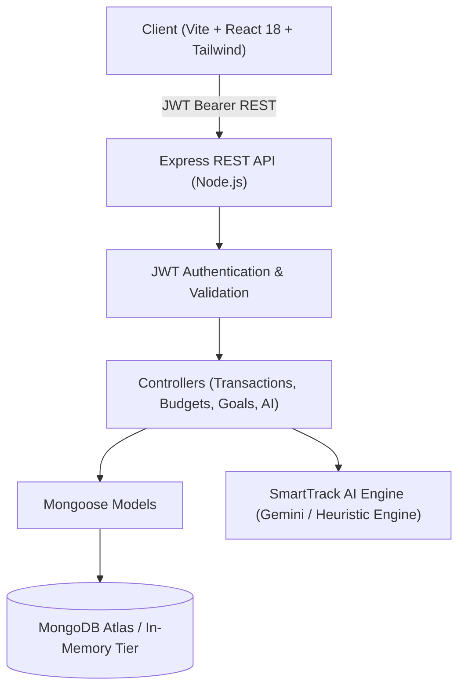

<h1 align="center">
  <br>
  ⚡ SmartTrack AI — Intelligent Personal Finance & Wealth Platform ⚡
  <br>
</h1>

<p align="center">
  <strong>Production-Grade Full-Stack MERN Personal Finance Ecosystem with AI Advisory, OCR Scanning, Predictive Forecasting & Budget Guardrails</strong>
</p>

<p align="center">
  <a href="https://github.com/codewithrashi07/smart-expense-tracker/actions"></a>
  <a href="https://react.dev/"></a>
  <a href="https://vitejs.dev/"></a>
  <a href="https://tailwindcss.com/"></a>
  <a href="https://nodejs.org/"></a>
  <a href="https://www.mongodb.com/atlas"></a>
  <a href="https://jwt.io/"></a>
  <a href="LICENSE"></a>
</p>

---

## 🌐 Live Deployments & Demos

- **Frontend Application:** [https://smart-exp-tracker.netlify.app/](https://smart-exp-tracker.netlify.app/)
- **GitHub Repository:** [https://github.com/codewithrashi07/smart-expense-tracker](https://github.com/codewithrashi07/smart-expense-tracker)

> **⚡ Instant Demo Access:** Click the **"⚡ Explore with Demo Account (Instant Access)"** button on the Login page to immediately experience the platform populated with real financial data, active budgets, savings goals, and AI insights.

---

## 💡 Overview & Product Transformation

**SmartTrack AI** is an enterprise-grade fintech platform transformed from a basic expense log into an intelligent personal finance OS. Designed with dark navy glassmorphism, responsive micro-interactions, dynamic charts, and automated financial intelligence, it empowers users to track income, control expenses, plan budgets with threshold alerts, forecast cashflow, and achieve savings milestones.



---

## ✨ Core Features & Functional Modules

### 1. 🔐 Security & User Authentication
- **Secure Password Hashing:** Powered by `bcryptjs` with salt rounds.
- **JWT Authentication:** Stateless, signed bearer tokens with auto-logout on expiry.
- **User Isolation:** All financial records, budgets, goals, and receipts are strictly scoped per authenticated user ID.
- **Profile Management:** Custom currency selector (USD, EUR, INR, GBP, CAD, AUD, JPY), bio, and monthly income targets.
- **Password Recovery:** Tokenized forgot/reset password flow.

### 2. 💸 Advanced Transaction Management
- **Ledger Inflows & Outflows:** Add, edit, and delete income and expense transactions.
- **Multi-Criteria Filtering:** Instant live search by title, notes, type, category, and payment method.
- **Sorting & Pagination:** Sort by date, amount, or merchant.
- **Receipt Attachments:** Upload image receipts directly to entries with modal previews.
- **CSV & PDF Exports:** One-click downloads formatted for Microsoft Excel, Apple Numbers, and audit logs.

### 3. 🎯 Smart Budget Guardrails
- **Monthly Category & Overall Caps:** Define spending limits per category or overall wallet.
- **Real-Time Progress Tracking:** Dynamically compares actual ledger spend against monthly limits.
- **Automated Threshold Warnings:** Visual indicator and system alerts triggered at:
  - 🟢 **Normal:** < 75% utilized
  - 🟡 **Warning:** 75% - 89% utilized
  - 🟠 **Critical:** 90% - 99% utilized
  - 🔴 **Exceeded:** >= 100% utilized

### 4. 🤖 AI Finance Advisor & Smart OCR Scanner
- **Dual-Mode AI Engine:**
  - **Cloud LLM Integration:** Connects to Google Gemini 1.5 Flash via `GEMINI_API_KEY`.
  - **Built-in Heuristic Engine:** Operates automatically in demo mode when no API key is provided, generating real dynamic insights from live ledger data.
- **Contextual Spending Analysis:** Identifies top-spend categories, evaluates the 50/30/20 rule, and recommends actionable savings optimizations.
- **Smart Receipt Scanner (OCR):** Upload receipt images to extract merchant, amount, date, and category with verification before saving.

### 5. 📊 Visual Analytics & Predictive Forecasting
- **Interactive Recharts:** Area charts for cashflow trends and donut charts for category distributions.
- **Financial Health Score (0-100):** Algorithmic rating combining savings rate, budget compliance, living expense ratio, and goal discipline.
- **Predictive Burn Rate Forecasting:** Calculates daily average burn rate, projected month-end outflow, and safe daily spending limit for remaining days in the cycle.

### 6. 🏆 Savings Goals & Milestones
- **Target Accumulation:** Create goals with target dates, visual badges, and deposit logs.
- **Celebration Confetti:** Interactive milestone celebrations when a goal achieves 100% completion.

### 7. 🔁 Subscriptions & Recurring Bills
- **Subscription Tracking:** Log monthly, weekly, or yearly recurring commitments (Netflix, AWS, Rent, Utilities).
- **One-Click Payment Processing:** Logs ledger transaction and advances the next due date automatically.

---

## 🛠 Tech Stack

### Frontend
- **Framework:** React 18.3, Vite 5.4
- **Styling:** Tailwind CSS 3.4 (Custom fintech theme & dark navy glassmorphism)
- **Routing:** React Router v6
- **Data Visualizations:** Recharts (AreaChart, BarChart, PieChart)
- **Icons:** Lucide React
- **PDF Generation:** jsPDF & jsPDF-autotable
- **Micro-interactions:** Canvas Confetti

### Backend
- **Runtime:** Node.js v18+ / v20+ / v24+
- **Framework:** Express.js 4
- **Database:** MongoDB Atlas via Mongoose 8
- **Authentication:** JSON Web Tokens (jsonwebtoken) & bcryptjs
- **File Uploads:** Multer with file type & size constraints
- **AI Processing:** Google Gemini API + SmartTrack Algorithmic Financial Intelligence Engine

---

## 📂 Project Directory Structure

```
smart-expense-tracker/
├── .github/
│   └── workflows/
│       └── webpack.yml           # GitHub Actions CI workflow
├── client/
│   ├── public/
│   │   └── _redirects            # Netlify SPA routing redirects
│   ├── src/
│   │   ├── components/           # Sidebar, Navbar, TransactionModal
│   │   ├── context/              # AuthContext & currency formatting
│   │   ├── pages/                # Dashboard, Ledger, Budgets, Analytics, Goals, AI, Reports, Profile
│   │   ├── services/             # API client with JWT bearer interceptors
│   │   ├── App.jsx               # React Router routes & layout
│   │   ├── index.css             # Tailwind base & glassmorphism
│   │   └── main.jsx
│   ├── tailwind.config.js
│   ├── vite.config.js
│   └── package.json
├── server/
│   ├── config/                   # MongoDB Atlas connection manager
│   ├── controllers/              # Auth, Transactions, Budgets, Analytics, Goals, AI, Recurring
│   ├── middleware/               # Auth protection, Multer upload, Error handler
│   ├── models/                   # User, Transaction, Budget, SavingsGoal, Recurring, Notification
│   ├── routes/                   # REST API route endpoints
│   ├── utils/                    # Financial health score, AI engine, demo seeder
│   ├── uploads/                  # Static receipt uploads
│   ├── app.js                    # Express app configuration & server boot
│   └── package.json
├── legacy-prototype/             # Preserved original static HTML/JS prototype
├── .gitignore
├── LICENSE
└── README.md
```

---

## ⚙️ Installation & Setup

### Prerequisites
- Node.js (v18 or higher)
- npm (v9 or higher)
- MongoDB Atlas account (free tier) or local MongoDB

### 1. Clone the Repository
```bash
git clone https://github.com/codewithrashi07/smart-expense-tracker.git
cd smart-expense-tracker
```

### 2. Backend Setup
```bash
cd server
npm install

# Copy environment example and configure
cp .env.example .env
```

Edit `server/.env`:
```env
PORT=5000
NODE_ENV=development
MONGO_URI=mongodb+srv://<username>:<password>@cluster0.mongodb.net/smarttrack?retryWrites=true&w=majority
JWT_SECRET=your_jwt_secret_key_change_in_production
JWT_EXPIRE=30d
GEMINI_API_KEY=your_gemini_api_key_optional
```

Start backend development server:
```bash
npm run dev
```
Backend runs at `http://localhost:5000` (Health check: `http://localhost:5000/api/health`).

### 3. Frontend Setup
```bash
cd ../client
npm install
npm run dev
```
Frontend runs at `http://localhost:5173`.

---

## 📡 REST API Reference

| Method | Endpoint | Description | Auth Required |
|---|---|---|:---:|
| `GET` | `/api/health` | System health check & DB status | No |
| `POST` | `/api/auth/register` | Register new user account | No |
| `POST` | `/api/auth/login` | Login user & issue JWT token | No |
| `GET` | `/api/auth/me` | Get current logged-in user profile | Yes |
| `PUT` | `/api/auth/profile` | Update profile, currency, & income target | Yes |
| `GET` | `/api/transactions` | Query ledger with search, category, date filters | Yes |
| `POST` | `/api/transactions` | Create new income/expense entry | Yes |
| `PUT` | `/api/transactions/:id` | Edit transaction entry | Yes |
| `DELETE`| `/api/transactions/:id` | Delete transaction entry | Yes |
| `POST` | `/api/transactions/upload-receipt` | Upload image receipt | Yes |
| `GET` | `/api/transactions/export/csv` | Export ledger as CSV | Yes |
| `GET` | `/api/budgets` | Fetch monthly budgets with spent calculation | Yes |
| `POST` | `/api/budgets` | Upsert budget limit for category/month | Yes |
| `GET` | `/api/analytics/overview` | Dashboard executive KPI summary | Yes |
| `GET` | `/api/analytics/trends` | 6/12 month income vs expense timeline | Yes |
| `GET` | `/api/analytics/forecast` | Predictive burn rate & daily spending limit | Yes |
| `GET` | `/api/goals` | Fetch savings goals | Yes |
| `POST` | `/api/goals/:id/contribute` | Deposit contribution towards savings goal | Yes |
| `GET` | `/api/recurring` | Fetch recurring subscriptions & bills | Yes |
| `POST` | `/api/recurring/:id/process`| Mark bill paid & auto-advance due date | Yes |
| `GET` | `/api/ai/insights` | Fetch automated spending insights | Yes |
| `POST` | `/api/ai/chat` | Interactive AI Financial Advisor prompt | Yes |
| `POST` | `/api/ai/scan-receipt` | OCR scan receipt for merchant, total & date | Yes |

---

## 🚀 Deployment Guide

### Deploying Frontend to Netlify
1. Connect your GitHub repository to [Netlify](https://www.netlify.com/).
2. Set **Base directory**: `client`
3. Set **Build command**: `npm run build`
4. Set **Publish directory**: `client/dist`
5. Add environment variable: `VITE_API_URL` = `https://your-backend.onrender.com`
6. Note: `client/public/_redirects` is already included to ensure React Router client-side routing works without 404 errors on reload.

### Deploying Backend to Render
1. Create a new **Web Service** on [Render](https://render.com/).
2. Set **Root Directory**: `server`
3. Set **Build Command**: `npm install`
4. Set **Start Command**: `node app.js`
5. Configure Environment Variables:
   - `NODE_ENV` = `production`
   - `PORT` = `10000`
   - `MONGO_URI` = `mongodb+srv://...`
   - `JWT_SECRET` = `<your-secure-secret>`
   - `GEMINI_API_KEY` = `<your-gemini-key>`

---

## 📄 License & Author

Distributed under the **MIT License**. See `LICENSE` for details.

**Author:** Rashi Yadav  
- **GitHub:** [@codewithrashi07](https://github.com/codewithrashi07)  
- **LinkedIn:** [rashi-yadav](https://linkedin.com/in/rashi-yadav-617ab437b/)  
- **Email:** rashiyadav684@gmail.com
